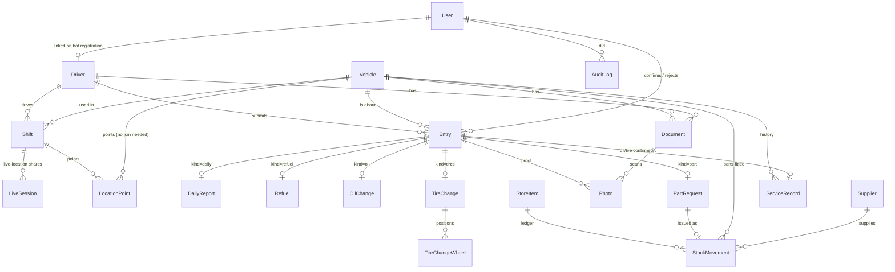

# Day 3 — Database design

Status: **approved** · 17.11.2026
Done when: schema reviewed.

PostgreSQL 16 + PostGIS 3.4, one Django app per area. Rules from the Day 1 kickoff are enforced **in the database** (check constraints, unique constraints, a trigger), so the bot, the web app and the Excel import can't break them, even through a bug.

## Diagram

## Tables by app

| App | Tables | Notes |
|---|---|---|
| `accounts` | **User** | Custom user: `role` (director, dispatcher, storekeeper, driver), `phone`, `telegram_id`, `language`, and four *approves_…* flags from the "Who confirms what" sheet |
| `fleet` | **Vehicle**, **Driver**, **Shift** | Plate stored without spaces (`01A123BC`), shown as `01 A 123 BC`. `Vehicle.odometer_km` = last **confirmed** value. Driver exists before they open the bot; `Driver.user` is linked on Day 7 |
| `tracking` | **LocationPoint**, **LiveSession**, **Geofence** | Points are PostGIS `Point` (WGS 84). Indexed by (vehicle, time), (shift, time) and time (nightly retention delete). A LiveSession is one Telegram live-location share; gaps between sessions are what the stop alert reports |
| `entries` | **Entry** + DailyReport, Refuel, OilChange, TireChange (+ wheels), PartRequest; **Photo** | One Entry row per driver submission holds status and who decided; the type's own fields sit in a one-to-one table. The dispatcher inbox is one query. Required photos and approver per kind are in `Entry.REQUIRED_PHOTOS` / `Entry.APPROVER_FLAG` |
| `store` | **StoreItem**, **Supplier**, **StockMovement** | Stock = sum of movements (opening, purchase, issue, adjustment). No stored "quantity" to drift from reality; every issue names the vehicle |
| `maintenance` | **ServiceInterval**, **ServiceRecord** | Interval per vehicle model and item (km or months, whichever first). A ServiceRecord comes from a confirmed entry, the import, or a repair; reminders read the latest one |
| `documents` | **Document** | Insurance, inspection, gas cylinder → vehicle; licence, power of attorney → driver. Scans are Photos |
| `audit` | **AuditLog** | Who, when, source (web/bot/system/import), what changed (`{"field": [before, after]}`), reason |
| `core` | **CompanySettings** | Single row: working hours/days, speed limits, retention (1 or 3 months), reminder time, stop-alert minutes |

Every column of the company data template has a home: `backend/fleet_import/mapping.py` (checked by an acceptance test).

## Rules the database enforces

| Rule | How |
|---|---|
| A driver can't be on two vehicles, a vehicle can't have two drivers | Partial unique index on open shifts (driver), and on open shifts (vehicle) |
| Only confirmed data counts; a decision says who and when | `entry_decision_matches_status`: pending ⇒ no decider; confirmed ⇒ decider + time; rejected ⇒ decider + time + reason |
| Odometer on every entry except part requests | `entry_odometer_required` |
| Every photo belongs to exactly one record, and is never duplicated | `photo_has_exactly_one_owner`, unique Telegram file id |
| Drivers can't approve | `driver_cannot_approve` |
| A second fuel needs its own norm and must differ from the first | `vehicle_second_fuel_complete`, `vehicle_second_fuel_differs` |
| Stock movements have the right sign; issues name a vehicle | `movement_sign_matches_kind`, `issue_has_vehicle` |
| Document type matches its owner | `document_owner_matches_type` |
| Retention is 1 or 3 months; one settings row | `settings_retention_1_or_3`, `settings_singleton` |
| Audit log can't be edited or deleted | Trigger refuses UPDATE and DELETE on `audit_auditlog` |
| Nothing with history is silently deleted | `PROTECT` on vehicles/drivers/items that have entries, shifts or movements; deactivate with `is_active` instead |

## Not in today's schema (added on their day)

Trips (Day 14), fines (Day 53), alerts and alert rules (Day 52), repairs with costs (Day 36: will write ServiceRecord + cost), fuel prices per type (Day 26). Each is a new table that points at what exists today; nothing here needs to change for them.

## Size check

≈ 60,000 location points a day → ≈ 5.4 M rows for 3 months, about 1 GB with indexes. One PostgreSQL handles this comfortably; if it grows, `tracking_locationpoint` can be partitioned by month without changing the models.

## Questions for review

| # | Question | Proposed answer |
|---|---|---|
| R1 | Wheel positions: front left/right, rear left/right, rear inner left/right, spare. Enough for all vehicles (any 3-axle trucks)? | Yes for Isuzu NPR / Damas-type fleet |
| R2 | Is a rejected entry fixed by the driver **re-sending** (new entry, linked to the old one), not by editing? | Yes — keeps the rejected photo as proof |
| R3 | Store: quantities with decimals (litres of oil) and pieces in the same table? | Yes, unit per item |
| R4 | Should a dispatcher be able to correct a confirmed entry? | No; only the director, with a reason in the audit log (kickoff rule 7) |
| R5 | Photos on the server's disk until Day 20, then MinIO | Yes |

## Sign-off

- [x] Product owner (Mirzokhid) — schema reviewed (17.11.2026)
